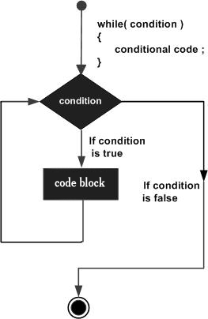

# Loop Control

Vòng lặp giúp máy lặp lại công việc thay cho bạn. Bài này nói về `while` — vòng lặp "kiểm tra trước, làm sau": chưa chắc chạy được vòng nào cả.

## Java Loops

Java programming language provides the following types of loops to handle the looping requirements:

`1	while loop`
Repeats a statement or group of statements while a given condition is true. It tests the condition before executing the loop body.

`2	for loop`
Execute a sequence of statements multiple times and abbreviates the code that manages the loop variable.

`3	do...while loop`
Like a while statement, except that it tests the condition at the end of the loop body.

`4	Enhanced for loop`
As of Java 5, the enhanced for loop was introduced. This is mainly used to traverse collection of elements including arrays.

Bốn vòng lặp như bốn kiểu chạy bộ: **while** chạy theo cảm giác mỏi (kiểm tra trước mỗi vòng), **for** chạy theo kế hoạch biết trước số vòng, **do...while** chạy thử trước rồi mới hỏi, **enhanced for** chạy theo lộ trình có sẵn từng điểm mốc.

## Loop Control Statements

`1	break statement`
Terminates the loop or switch statement and transfers execution to the statement immediately following the loop or switch.

`2	continue statement`
Causes the loop to skip the remainder of its body and immediately retest its condition prior to reiterating.

`break` là chuông bỏ cuộc — thoát hẳn vòng lặp; `continue` là bỏ qua một vòng — nhảy thẳng sang vòng kế tiếp. (Chi tiết ở bài [6_break-continue](../6_break-continue/README.md).)

## Java while Loop

> A while loop statement in Java programming language repeatedly executes a code block as long as a given condition is true.

Nói theo cách đời thường: `while` như **hàm ý "trong khi còn cạn chén thì rót tiếp"** — trước mỗi lần rót, bạn liếc xem chén cạn chưa; điều kiện sai ngay từ đầu thì không rót giọt nào. Đây là điểm khác then chốt với `do...while`.

### Syntax of while Loop

> 📄 **Code ví dụ:** [`examples/01-syntax-of-while-loop.java`](examples/01-syntax-of-while-loop.java)

> **Tóm gọn 1 câu:** `while` là "kiểm tra rồi mới làm" — điều kiện sai từ đầu thì thân lặp không chạy lấy một lần.

### Execution Process of a while Loop

- Here, statement(s) may be a single statement or a block of statements. The condition may be any expression, and true is any non zero value.
- When executing, if the boolean_expression result is true, then the actions inside the loop will be executed. This will continue as long as the expression result is true.
- When the condition becomes false, program control passes to the line immediately following the loop.

Chu trình như **quay quanh trục**: điều kiện là "cửa kiểm" đứng trước, mỗi vòng phải qua cửa này; chỉ cần một lần cửa đóng (điều kiện false), dòng chạy trượt ngay xuống câu lệnh kế tiếp sau vòng lặp.

Điều quan trọng cần nhớ: bên trong thân lặp phải có điều gì đó **làm điều kiện dần dần sai đi** (tăng/giảm biến đếm, đổi trạng thái...) — nếu không, bạn tự tay xây một vòng lặp vô hạn.

### Flow Diagram

> **Tóm gọn 1 câu:** `while` xoay quanh một cửa kiểm duyệt — qua cửa thì làm việc, cửa đóng thì thoát; và đừng quên "bón" cho điều kiện một con đường để sai đi.
