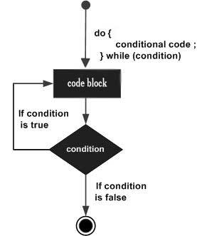

# Loop Control

Vòng lặp giúp máy lặp lại công việc thay cho bạn. Bài này nói về `do...while` — vòng lặp "làm trước, hỏi sau": đảm bảo chạy ít nhất một lần.

## Java Loops

Java programming language provides the following types of loops to handle the looping requirements:

`1	while loop`
Repeats a statement or group of statements while a given condition is true. It tests the condition before executing the loop body.

`2	for loop`
Execute a sequence of statements multiple times and abbreviates the code that manages the loop variable.

`3	do...while loop`
Like a while statement, except that it tests the condition at the end of the loop body.

`4	Enhanced for loop`
As of Java 5, the enhanced for loop was introduced. This is mainly used to traverse collection of elements including arrays.

Bốn vòng lặp như bốn kiểu chạy bộ: **while** chạy theo cảm giác mỏi (kiểm tra trước mỗi vòng), **for** chạy theo kế hoạch biết trước số vòng, **do...while** chạy thử một vòng rồi mới hỏi "chạy tiếp không?", **enhanced for** chạy theo lộ trình có sẵn từng điểm mốc.

## Loop Control Statements

`1	break statement`
Terminates the loop or switch statement and transfers execution to the statement immediately following the loop or switch.

`2	continue statement`
Causes the loop to skip the remainder of its body and immediately retest its condition prior to reiterating.

`break` là chuông bỏ cuộc — thoát hẳn vòng lặp; `continue` là bỏ qua một vòng — nhảy thẳng sang vòng kế tiếp. (Chi tiết ở bài [6_break-continue](../6_break-continue/README.md).)

## Java do-while Loop

> A while loop statement in Java programming language repeatedly executes a code block as long as a given condition is true.

Nói theo cách đời thường: `do...while` là kiểu **"nếm thử rồi mới quyết"** — món mới đưa lên miệng trước (thân lặp chạy trước), sau đó mới xét "có gọi thêm phần nữa không" (điều kiện kiểm tra sau). Cho dù trả lời là "không", bạn vẫn đã nếm đúng một phần — đó là lời bảo đảm "chạy ít nhất một lần" của do...while.

### Syntax of do-while Loop

> 📄 **Code ví dụ:** [`examples/01-syntax-of-do-while-loop.java`](examples/01-syntax-of-do-while-loop.java)

> **Tóm gọn 1 câu:** `do...while` là "nếm trước, hỏi sau" — thân lặp chạy ít nhất một lần rồi mới xét điều kiện.

### Execution Process of a do-while Loop

- A do while loop is similar to a while loop, except that a do while loop is guaranteed to execute at least one time.

Điểm khác biệt duy nhất nằm ở **vị trí cửa kiểm duyệt**: `while` đặt cửa trước cửa nhà (điều kiện xét trước), `do...while` đặt cửa ở hậu viện (điều kiện xét sau) — khách luôn được vào nhà một lần, chừng đó mới kiểm tra cho lượt tiếp theo.

Vì vậy, do...while phù hợp với các tình huống "bắt buộc làm một lần": hiện menu cho người dùng chọn, đọc input đầu tiên, thử kết nối lần đầu...

### Flow Diagram

> **Tóm gọn 1 câu:** `do...while` khác `while` đúng một chỗ — cửa kiểm duyệt đặt ở cuối, nhờ vậy thân lặp luôn chạy được ít nhất một lần.
