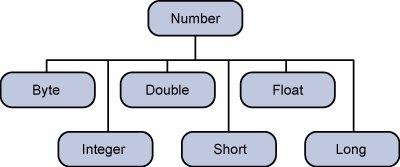

# Lớp Numbers

- Thông thường, khi làm việc với số, ta dùng **kiểu dữ liệu nguyên thủy** như `byte`, `int`, `long`, `double`...

```java
int i = 5000;
float gpa = 13.65f;
double mask = 125;
```

- Đôi khi, có những tình huống cần dùng **đối tượng** thay vì kiểu nguyên thủy (ví dụ: lưu vào collection, dùng generic). Để làm được điều đó, Java cung cấp các **lớp wrapper**.
- Tất cả các lớp wrapper (Integer, Long, Byte, Double, Float, Short) đều là con của lớp trừu tượng `Number`.

## Lớp Number

> `Number` là một lớp trừu tượng trong gói `java.lang`. Nó là **lớp cha** của các lớp biểu diễn giá trị số có thể chuyển về kiểu nguyên thủy như `byte`, `short`, `int`, `long`, `float`, `double`.



- Đối tượng wrapper **"bọc" (wrap)** giá trị kiểu nguyên thủy tương ứng. Việc chuyển kiểu nguyên thủy thành đối tượng gọi là **boxing**, compiler tự lo việc này.
- Do đó khi dùng wrapper, bạn chỉ cần truyền giá trị nguyên thủy vào constructor của lớp wrapper.
- Ngược lại, đối tượng wrapper được chuyển về kiểu nguyên thủy gọi là **unboxing**. Lớp `Number` thuộc gói `java.lang`.

```java
public class Test {
   public static void main(String args[]) {
      Integer x = 5; // boxes int to an Integer object
      x =  x + 10;   // unboxes the Integer to a int
      System.out.println(x); 
   }
}
```

## Các phương thức của lớp Number

| # | Phương thức | Mô tả |
|---|-------------|-------|
| 1 | `byteValue()` | Trả về giá trị của số dưới dạng `byte` |
| 2 | `doubleValue()` | Trả về giá trị của số dưới dạng `double` |
| 3 | `floatValue()` | Trả về giá trị của số dưới dạng `float` |
| 4 | `intValue()` | Trả về giá trị của số dưới dạng `int` |
| 5 | `longValue()` | Trả về giá trị của số dưới dạng `long` |
| 6 | `compareTo()` | So sánh đối tượng Number này với tham số |
| 7 | `equals()` | Xác định đối tượng số này có bằng tham số không |
| 8 | `valueOf()` | Trả về đối tượng Integer chứa giá trị của kiểu nguyên thủy chỉ định |
| 9 | `toString()` | Trả về chuỗi biểu diễn giá trị của số |
| 10 | `parseInt()` | Chuyển một chuỗi (String) thành kiểu nguyên thủy tương ứng |
| 11 | `min()` | Trả về giá trị nhỏ hơn trong hai tham số |
| 12 | `max()` | Trả về giá trị lớn hơn trong hai tham số |

## Các lớp Wrapper trong Java

| # | Lớp | Mô tả |
|---|-----|-------|
| 1 | `Boolean` | Bọc giá trị kiểu nguyên thủy `boolean` trong một đối tượng |
| 2 | `Byte` | Bọc giá trị kiểu `byte` trong một đối tượng |
| 3 | `Character` | Bọc giá trị kiểu `char` trong một đối tượng |
| 4 | `Double` | Bọc giá trị kiểu `double` trong một đối tượng |
| 5 | `Float` | Bọc giá trị kiểu `float` trong một đối tượng |
| 6 | `Integer` | Bọc giá trị kiểu `int` trong một đối tượng |
| 7 | `Long` | Bọc giá trị kiểu `long` trong một đối tượng |
| 8 | `Short` | Bọc giá trị kiểu `short` trong một đối tượng |

> Lưu ý: `Character` và `Boolean` không kế thừa từ `Number` (vì không phải kiểu số); các wrapper còn lại đều là con của `Number`.
