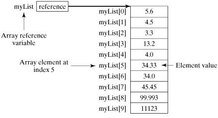

# Mảng (Arrays)

Vậy khi cần lưu 100 điểm thi, bạn phải khai báo 100 biến riêng sao? Không — có **mảng (array)**: một "tủ ngăn kéo" chứa nhiều ô cùng loại, đánh số thứ tự. Mục này nói về cách mở tủ, xếp đồ và lấy đồ ra.

## Mảng trong Java là gì?

- Java cung cấp một cấu trúc dữ liệu gọi là **mảng (array)** — lưu trữ một tập hợp **cố định số phần tử**, tuần tự, cùng một kiểu dữ liệu. Mảng dùng để lưu tập hợp dữ liệu, nhưng thường hữu ích hơn nếu bạn hình dung nó như một tập các biến cùng kiểu.

- Thay vì khai báo từng biến riêng lẻ như `number0`, `number1`, ..., `number99`, bạn khai báo **một** biến mảng như `numbers` rồi dùng `numbers[0]`, `numbers[1]`, ..., `numbers[99]` để truy cập từng phần tử.

Ví von: mảng là **tủ locker có ngăn được đánh số từ 0** — một tủ duy nhất nhưng 100 ngăn, lấy đồ chỉ cần báo số ngăn. Lưu ý ngăn đầu tiên là số **0**, không phải 1 — như tầng trệt được gọi là tầng 0.

## Khai báo biến mảng

Mục này nói về bước "đăng ký tủ": khai báo biến tham chiếu và kiểu dữ liệu của tủ trước khi đặt mua.

Để dùng mảng, bạn phải khai báo một biến tham chiếu tới mảng và chỉ định kiểu dữ liệu của mảng:

### Cú pháp

> 📄 **Code ví dụ:** [`examples/01-cu-phap.java`](examples/01-cu-phap.java)

### Ví dụ

> 📄 **Code ví dụ:** [`examples/02-vi-du.java`](examples/02-vi-du.java)

Cách đầu tiên (`double[] myList;`) được khuyến khích vì kiểu dữ liệu đứng rõ ràng trước tên biến — đọc "double-array tên là myList" liền một mạch, như đọc nhãn dán trên tủ.

## Tạo mảng

Mục này là bước "đặt mua và ghi rõ số ngăn": khai báo xong mới chỉ có nhãn, phải `new` với số phần tử thì tủ mới thực sự tồn tại.

### Cú pháp

> 📄 **Code ví dụ:** [`examples/03-cu-phap.java`](examples/03-cu-phap.java)

### Ví dụ

> 📄 **Code ví dụ:** [`examples/04-vi-du.java`](examples/04-vi-du.java)

## Xử lý mảng

Mục này nói về cách "đi qua từng ngăn tủ" để làm việc với dữ liệu — bằng vòng lặp for/foreach. Đọc để thấy vì sao mảng và vòng lặp là cặp bài trùng.

- Khi làm việc với các phần tử của mảng, ta thường dùng vòng lặp `for` hoặc `foreach`, vì tất cả phần tử cùng kiểu và kích thước mảng đã biết trước.

> 📄 **Code ví dụ:** [`examples/05-xu-ly-mang.java`](examples/05-xu-ly-mang.java)

### Vòng lặp foreach với mảng

> 📄 **Code ví dụ:** [`examples/06-vong-lap-foreach-voi-mang.java`](examples/06-vong-lap-foreach-voi-mang.java)

### Truyền mảng vào phương thức

> 📄 **Code ví dụ:** [`examples/07-truyen-mang-vao-phuong-thuc.java`](examples/07-truyen-mang-vao-phuong-thuc.java)

### Trả về mảng từ phương thức

> 📄 **Code ví dụ:** [`examples/08-tra-ve-mang-tu-phuong-thuc.java`](examples/08-tra-ve-mang-tu-phuong-thuc.java)

## Lớp Arrays (java.util)

Mục này mở "hộp công cụ có sẵn" của Java cho mảng: tìm kiếm, so sánh, đổ đầy, sắp xếp — không phải tự viết tay những thao tác quen thuộc này.

Lớp `java.util.Arrays` cung cấp sẵn nhiều phương thức tĩnh để làm việc với mảng:

Cách đọc nhanh danh sách dưới đây: nhóm theo việc cần làm — **tìm** (binarySearch), **so sánh** (equals), **đổ giá trị** (fill), **sắp xếp** (sort); mỗi mục ghi rõ điều kiện dùng, ví dụ binarySearch chỉ đúng khi mảng **đã sắp xếp trước**.

**1	public static int binarySearch(Object[] a, Object key)**

Tìm kiếm nhị phân một giá trị trong mảng đã được **sắp xếp trước**. Trả về chỉ số của giá trị nếu tìm thấy; ngược lại trả về (– (vị trí chèn + 1)).

**2	public static boolean equals(long[] a, long[] a2)**

Trả về `true` nếu hai mảng bằng nhau — cùng số phần tử và mọi cặp phần tử tương ứng đều bằng nhau. Cách dùng tương tự cho mọi kiểu nguyên thủy khác (byte, short, int...).

**3	public static void fill(int[] a, int val)**

Gán giá trị `val` cho **mọi** phần tử của mảng. Cũng dùng được cho các kiểu nguyên thủy khác.

**4	public static void sort(Object[] a)**

Sắp xếp mảng theo thứ tự tăng dần theo thứ tự tự nhiên của phần tử. Cũng dùng được cho các kiểu nguyên thủy khác.

> **Tóm gọn 1 câu:** Mảng là "tủ locker đánh số từ 0" — khai báo nhãn, `new` số ngăn, rồi for/foreach đi từng ngăn; việc nhàm chán nào cũng có sẵn trong lớp `Arrays`.
