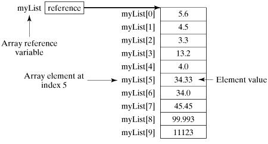

# Mảng (Arrays)

## Mảng trong Java là gì?

- Java cung cấp một cấu trúc dữ liệu gọi là **mảng (array)** — lưu trữ một tập hợp **cố định số phần tử**, tuần tự, cùng một kiểu dữ liệu. Mảng dùng để lưu tập hợp dữ liệu, nhưng thường hữu ích hơn nếu bạn hình dung nó như một tập các biến cùng kiểu.

- Thay vì khai báo từng biến riêng lẻ như `number0`, `number1`, ..., `number99`, bạn khai báo **một** biến mảng như `numbers` rồi dùng `numbers[0]`, `numbers[1]`, ..., `numbers[99]` để truy cập từng phần tử.

## Khai báo biến mảng

Để dùng mảng, bạn phải khai báo một biến tham chiếu tới mảng và chỉ định kiểu dữ liệu của mảng:

### Cú pháp

```java
dataType[] arrayRefVar;   // preferred way.
or
dataType arrayRefVar[];  // works but not preferred way.
```

### Ví dụ

```java
double[] myList;   // preferred way.
or
double myList[];   // works but not preferred way.
```

Cách đầu tiên (`double[] myList;`) được khuyến khích vì kiểu dữ liệu đứng rõ ràng trước tên biến.

## Tạo mảng

### Cú pháp

```java
arrayRefVar = new dataType[arraySize];

dataType[] arrayRefVar = new dataType[arraySize];

dataType[] arrayRefVar = {value0, value1, ..., valuek};
```

### Ví dụ

```java
double[] myList = new double[10]; // 10 is size of myList
```



## Xử lý mảng

- Khi làm việc với các phần tử của mảng, ta thường dùng vòng lặp `for` hoặc `foreach`, vì tất cả phần tử cùng kiểu và kích thước mảng đã biết trước.

```java
public class TestArray {

   public static void main(String[] args) {
      double[] myList = {1.9, 2.9, 3.4, 3.5};

      // Print all the array elements
      for (int i = 0; i < myList.length; i++) {
         System.out.println(myList[i] + " ");
      }
     
      // Summing all elements
      double total = 0;
      for (int i = 0; i < myList.length; i++) {
         total += myList[i];
      }
      System.out.println("Total is " + total);
      
      // Finding the largest element
      double max = myList[0];
      for (int i = 1; i < myList.length; i++) {
         if (myList[i] > max) max = myList[i];
      }
      System.out.println("Max is " + max);  
   }
}
```

### Vòng lặp foreach với mảng

```java
public class TestArray {

   public static void main(String[] args) {
      double[] myList = {1.9, 2.9, 3.4, 3.5};

      // Print all the array elements
      for (double element: myList) {
         System.out.println(element);
      }
   }
}
```

### Truyền mảng vào phương thức

```java
public static void printArray(int[] array) {
   for (int i = 0; i < array.length; i++) {
      System.out.print(array[i] + " ");
   }
}

printArray(new int[]{3, 1, 2, 6, 4, 2});
```

### Trả về mảng từ phương thức

```java
public static int[] reverse(int[] list) {
   int[] result = new int[list.length];

   for (int i = 0, j = result.length - 1; i < list.length; i++, j--) {
      result[j] = list[i];
   }
   return result;
}
```

## Lớp Arrays (java.util)

Lớp `java.util.Arrays` cung cấp sẵn nhiều phương thức tĩnh để làm việc với mảng:

**1	public static int binarySearch(Object[] a, Object key)**

Tìm kiếm nhị phân một giá trị trong mảng đã được **sắp xếp trước**. Trả về chỉ số của giá trị nếu tìm thấy; ngược lại trả về (– (vị trí chèn + 1)).

**2	public static boolean equals(long[] a, long[] a2)**

Trả về `true` nếu hai mảng bằng nhau — cùng số phần tử và mọi cặp phần tử tương ứng đều bằng nhau. Cách dùng tương tự cho mọi kiểu nguyên thủy khác (byte, short, int...).

**3	public static void fill(int[] a, int val)**

Gán giá trị `val` cho **mọi** phần tử của mảng. Cũng dùng được cho các kiểu nguyên thủy khác.

**4	public static void sort(Object[] a)**

Sắp xếp mảng theo thứ tự tăng dần theo thứ tự tự nhiên của phần tử. Cũng dùng được cho các kiểu nguyên thủy khác.
