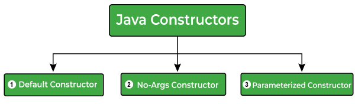

# Constructors (Hàm tạo)

> `Constructor` trong Java là loại phương thức đặc biệt dùng để **khởi tạo đối tượng ngay khi nó được tạo**. Constructor có cùng tên với lớp và cú pháp giống một phương thức bình thường, nhưng **không có kiểu trả về tường minh.**

Ví von: constructor là "thủ tục nhận nhà" — ngay lúc bạn cầm chìa khóa (`new`), mọi thứ đã được lắp đặt sẵn: điện, nước, đồ nội thất ban đầu; bạn không phải dọn vào một căn nhà trống rồi tự lo sau.

- Thông thường, bạn sẽ sử dụng một hàm tạo để cung cấp các giá trị ban đầu cho các biến thể hiện hoặc thực hiện bất kỳ quy trình khởi động nào khác cần thiết để tạo ra một đối tượng hoàn chỉnh.

- Tất cả các lớp đều có hàm tạo, bất kể bạn có định nghĩa hàm tạo hay không thì Java đều tự động cung cấp một hàm tạo mặc định, khởi tạo tất cả các biến thành viên. Tuy nhiên, sau khi bạn định nghĩa hàm tạo của mình, hàm tạo mặc định sẽ không còn được sử dụng nữa.

## Quy tắc tạo constructor trong Java

Mục này liệt kê 5 quy tắc "luật chơi" của constructor — nhớ 5 dòng này là tránh được phần lớn lỗi khi viết hàm tạo.

- Tên của constructor **phải trùng với tên lớp**.
- Constructor **không có kiểu trả về** — thậm chí không dùng `void`.
- Có thể có nhiều constructor trong cùng một lớp — khái niệm này gọi là **constructor overloading**.
- Constructor có thể dùng access modifier nếu bạn muốn thay đổi phạm vi truy cập của chúng.
- Java cung cấp `default` constructor được gọi khi tạo đối tượng. Nếu bạn tự tạo bất kỳ constructor nào, default constructor (do Java cung cấp) sẽ không còn được gọi nữa.

> **Tóm gọn 1 câu:** Constructor là "thủ tục nhận nhà" — tên trùng lớp, không kiểu trả về, và tự viết một cái là mất cái mặc định của Java.

## Tạo một constructor

Mục này cho xem cú pháp thật của constructor qua code — nhìn ví dụ là hiểu quy tắc ở mục trên được áp dụng thế nào.

Cú pháp:

> 📄 **Code ví dụ:** [`examples/01-tao-mot-constructor.java`](examples/01-tao-mot-constructor.java)

Ví dụ:

> 📄 **Code ví dụ:** [`examples/02-tao-mot-constructor.java`](examples/02-tao-mot-constructor.java)

## Các loại constructor trong Java

Mục này phân loại 3 "dạng nhận nhà" phổ biến: nhà bàn giao sẵn cấu hình mặc định, nhà bạn tự cấu hình không tham số, và nhà cấu hình theo yêu cầu (có tham số).

Java có 3 loại constructor, liệt kê như sau:

- Default Constructor (hàm tạo mặc định do Java sinh)
- No-Args Constructor (hàm tạo không tham số — do bạn viết)
- Parameterized Constructor (hàm tạo có tham số)

### Default Constructor

> Nếu bạn **không tạo** constructor nào trong lớp, Java sẽ cung cấp một default constructor để khởi tạo đối tượng (các field nhận giá trị mặc định: số = 0, boolean = false, tham chiếu = null).

Ví von: giống thuê căn nhà chung chủ "bàn giao nguyên trạng" — không có gì đặc biệt, mọi thứ ở mức mặc định.

Ví dụ: lớp không có bất kỳ constructor nào

> 📄 **Code ví dụ:** [`examples/03-default-constructor.java`](examples/03-default-constructor.java)

### No-Args (No Argument) Constructor

> Như tên gọi, constructor không tham số **không nhận bất kỳ tham số nào**. Dùng no-args constructor, bạn có thể khởi tạo các thành viên dữ liệu của lớp và thực hiện các hành động khác mà bạn muốn ngay khi tạo đối tượng.

Ví von: cùng là nhà không tham số, nhưng lần này là bạn tự sơn sửa, kê đồ trước khi nhận — chủ động hơn default của Java.

Ví dụ:

> 📄 **Code ví dụ:** [`examples/04-no-args-no-argument-constructor.java`](examples/04-no-args-no-argument-constructor.java)

### Parameterized Constructor

> Constructor có một hoặc nhiều tham số gọi là **parameterized constructor**.

Ví von: như đặt nhà theo yêu cầu — bạn đưa thông số (diện tích, hướng, màu sơn) ngay trong đơn đặt hàng, nhận nhà là đúng ý ngay lần đầu.

- Tham số được thêm vào constructor giống như với phương thức: chỉ cần khai báo chúng trong ngoặc đơn ngay sau tên constructor.

Ví dụ 1:

> 📄 **Code ví dụ:** [`examples/05-parameterized-constructor.java`](examples/05-parameterized-constructor.java)

Ví dụ 2:

> 📄 **Code ví dụ:** [`examples/06-parameterized-constructor.java`](examples/06-parameterized-constructor.java)

Bạn gọi constructor để khởi tạo đối tượng như sau:

> 📄 **Code ví dụ:** [`examples/07-parameterized-constructor.java`](examples/07-parameterized-constructor.java)

## Constructor Overloading trong Java

Mục này nói về việc có nhiều "cửa nhận nhà" trong cùng một class: khách đi cửa nào cũng được, miễn là mang đúng giấy tờ (tham số) mà cửa đó yêu cầu.

Constructor overloading nghĩa là **nhiều constructor trong cùng một lớp**, mỗi constructor nhận một danh sách tham số khác nhau. Khi tạo đối tượng, constructor nào khớp với tham số truyền vào sẽ được gọi.

> 📄 **Code ví dụ:** [`examples/08-constructor-overloading-trong-java.java`](examples/08-constructor-overloading-trong-java.java)

> **Tóm gọn 1 câu:** Constructor overloading là "nhiều cửa nhận nhà cho nhiều kiểu khách" — Java tự chọn đúng cửa theo tham số bạn truyền vào.
