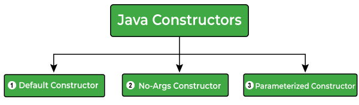

# Constructors (Hàm tạo)

> `Constructor` trong Java là loại phương thức đặc biệt dùng để **khởi tạo đối tượng ngay khi nó được tạo**. Constructor có cùng tên với lớp và cú pháp giống một phương thức bình thường, nhưng **không có kiểu trả về tường minh.**

- Thông thường, bạn sẽ sử dụng một hàm tạo để cung cấp các giá trị ban đầu cho các biến thể hiện hoặc thực hiện bất kỳ quy trình khởi động nào khác cần thiết để tạo ra một đối tượng hoàn chỉnh.

- Tất cả các lớp đều có hàm tạo, bất kể bạn có định nghĩa hàm tạo hay không thì Java đều tự động cung cấp một hàm tạo mặc định, khởi tạo tất cả các biến thành viên. Tuy nhiên, sau khi bạn định nghĩa hàm tạo của mình, hàm tạo mặc định sẽ không còn được sử dụng nữa.

## Quy tắc tạo constructor trong Java

- Tên của constructor **phải trùng với tên lớp**.
- Constructor **không có kiểu trả về** — thậm chí không dùng `void`.
- Có thể có nhiều constructor trong cùng một lớp — khái niệm này gọi là **constructor overloading**.
- Constructor có thể dùng access modifier nếu bạn muốn thay đổi phạm vi truy cập của chúng.
- Java cung cấp `default` constructor được gọi khi tạo đối tượng. Nếu bạn tự tạo bất kỳ constructor nào, default constructor (do Java cung cấp) sẽ không còn được gọi nữa.

## Tạo một constructor

Cú pháp:

```java
class ClassName {
   ClassName() {
   }
}
```

Ví dụ:

```java
public class Main {
  // Creating a constructor
  Main() {
    System.out.println("Hello, World!");
  }

  public static void main(String[] args) {
    System.out.println("The main() method.");

    // Creating a class's object
    // that will invoke the constructor
    Main obj_x = new Main();
  }
}
```

## Các loại constructor trong Java

Java có 3 loại constructor, liệt kê như sau:

- Default Constructor (hàm tạo mặc định do Java sinh)
- No-Args Constructor (hàm tạo không tham số — do bạn viết)
- Parameterized Constructor (hàm tạo có tham số)



### Default Constructor

> Nếu bạn **không tạo** constructor nào trong lớp, Java sẽ cung cấp một default constructor để khởi tạo đối tượng (các field nhận giá trị mặc định: số = 0, boolean = false, tham chiếu = null).

Ví dụ: lớp không có bất kỳ constructor nào

```java
public class Main {
  int num1;
  int num2;

  public static void main(String[] args) {
    // We didn't created any structure
    // a default constructor will invoke here
    Main obj_x = new Main();

    // Printing the values
    System.out.println("num1 : " + obj_x.num1);
    System.out.println("num2 : " + obj_x.num2);
  }
}                    
```

### No-Args (No Argument) Constructor

> Như tên gọi, constructor không tham số **không nhận bất kỳ tham số nào**. Dùng no-args constructor, bạn có thể khởi tạo các thành viên dữ liệu của lớp và thực hiện các hành động khác mà bạn muốn ngay khi tạo đối tượng.

Ví dụ:

```java
public class Main {
  int num1;
  int num2;

  // Creating no-args constructor
  Main() {
    num1 = -1;
    num2 = -1;
  }

  public static void main(String[] args) {
    // no-args constructor will invoke
    Main obj_x = new Main();

    // Printing the values
    System.out.println("num1 : " + obj_x.num1);
    System.out.println("num2 : " + obj_x.num2);
  }
}
```

### Parameterized Constructor

> Constructor có một hoặc nhiều tham số gọi là **parameterized constructor**.

- Tham số được thêm vào constructor giống như với phương thức: chỉ cần khai báo chúng trong ngoặc đơn ngay sau tên constructor.

Ví dụ 1:

```java
public class Main {
  int num1;
  int num2;

  // Creating parameterized constructor 
  Main(int a, int b) {
    num1 = a;
    num2 = b;
  }

  public static void main(String[] args) {
    // Creating two objects by passing the values 
    // to initialize the attributes.
    // parameterized constructor will invoke
    Main obj_x = new Main(10, 20);
    Main obj_y = new Main(100, 200);

    // Printing the objects values
    System.out.println("obj_x");
    System.out.println("num1 : " + obj_x.num1);
    System.out.println("num2 : " + obj_x.num2);

    System.out.println("obj_y");
    System.out.println("num1 : " + obj_y.num1);
    System.out.println("num2 : " + obj_y.num2);
  }
}
```

Ví dụ 2:

```java
// A simple constructor.
class MyClass {
   int x;
    
   // Following is the constructor
   MyClass(int i ) {
      x = i;
   }
}
```

Bạn gọi constructor để khởi tạo đối tượng như sau:

```java
public class ConsDemo {
   public static void main(String args[]) {
      MyClass t1 = new MyClass( 10 );
      MyClass t2 = new MyClass( 20 );
      System.out.println(t1.x + " " + t2.x);
   }
}
```

## Constructor Overloading trong Java

Constructor overloading nghĩa là **nhiều constructor trong cùng một lớp**, mỗi constructor nhận một danh sách tham số khác nhau. Khi tạo đối tượng, constructor nào khớp với tham số truyền vào sẽ được gọi.

```java
// Example of Java Constructor Overloading
// Creating a Student Class
class Student {
  String name;
  int age;

  // no-args constructor
  Student() {
    this.name = "Unknown";
    this.age = 0;
  }

  // parameterized constructor having one parameter
  Student(String name) {
    this.name = name;
    this.age = 0;
  }

  // parameterized constructor having both parameters
  Student(String name, int age) {
    this.name = name;
    this.age = age;
  }

  public void printDetails() {
    System.out.println("Name : " + this.name);
    System.out.println("Age : " + this.age);
  }
}

public class Main {
  public static void main(String[] args) {
    Student std1 = new Student(); // invokes no-args constructor
    Student std2 = new Student("Jordan"); // invokes parameterized constructor
    Student std3 = new Student("Paxton", 25); // invokes parameterized constructor

    // Printing details
    System.out.println("std1...");
    std1.printDetails();

    System.out.println("std2...");
    std2.printDetails();

    System.out.println("std3...");
    std3.printDetails();
  }
}
```
